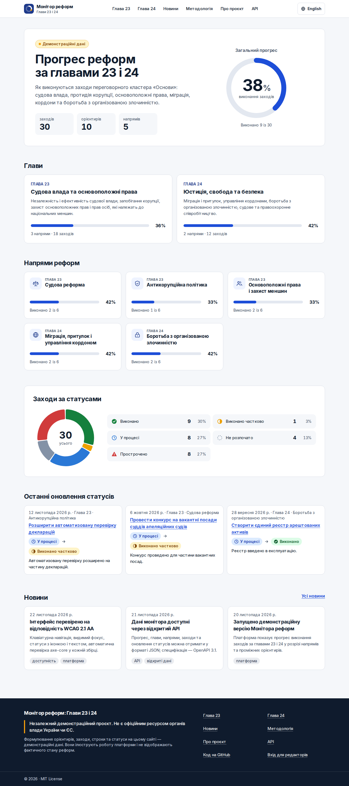
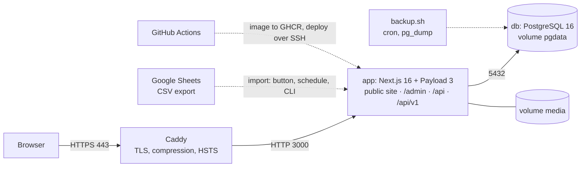

# Reform Monitor: Chapters 23 and 24

An independent open-source project: a platform for tracking the implementation of reform measures under EU accession Chapter 23 "Judiciary and Fundamental Rights" and Chapter 24 "Justice, Freedom and Security" (the "Fundamentals" negotiating cluster).

> **Independent demonstration project. Not an official resource of the authorities of Ukraine or the EU.**
> Benchmark wording, measures, deadlines and statuses are **demonstration data**: they illustrate how the platform works and do not reflect the actual state of reforms.

Demo: <http://185.67.0.246:8081>



## Features

| Feature | How it is implemented |
|---|---|
| Two languages | `uk` without a prefix, `en` under `/en/`; content localisation in Payload plus next-intl for the interface; hreflang, canonical and sitemap in both languages |
| Data hierarchy | Chapter → reform direction → interim benchmark → measure → status update |
| Automatic progress | Done = 1, partially done = 0.5; "overdue" is derived from the deadline |
| Roles with permissions stored as data | A `roles` collection with a read / write / delete matrix per collection; a single access function; a new collection appears in the matrix automatically |
| Audit log | Hooks on every collection, before/after snapshots, CSV export; UPDATE/DELETE are blocked by a database trigger, even for an administrator |
| Data migration | Idempotent import from Google Sheets (or CSV): admin button, schedule, CLI; a log of runs |
| Accessibility | WCAG 2.1 AA in the project's own code, no overlays; axe-core in Playwright blocks CI |
| Open API | `/api/v1/*`, OpenAPI 3.1, rate limiting |
| Deployment | `docker compose up -d`; Caddy with automatic HTTPS; backups; CI/CD |

Screenshots: [direction with accordion and filters](docs/screenshots/direction.png) · [measure page](docs/screenshots/measure.png) · [mobile, 360 px](docs/screenshots/home-mobile.png) · [role permission matrix](docs/screenshots/admin-role-matrix.png) · [audit log](docs/screenshots/admin-audit-log.png) · [sync runs](docs/screenshots/admin-sync-runs.png)

## Architecture



A single image contains the public site, the admin panel and the API. Kubernetes is not used, only Docker Compose. Details: [docs/architecture.md](docs/architecture.md).

## Stack

Next.js 16 (App Router, Server Components) · TypeScript · Tailwind CSS 4 · Payload CMS 3 · PostgreSQL 16 · next-intl · Recharts · Vitest · Playwright + axe-core · Lighthouse CI · k6 · Docker Compose · Caddy · GitHub Actions.

## Quick start (local)

Only Docker is required (Docker Desktop, or Docker Engine with the Compose plugin). Node.js is not needed on the host.

```bash
cp .env.example .env
# in .env replace PAYLOAD_SECRET (openssl rand -hex 32) and the database and administrator passwords
docker compose up -d
docker compose ps        # app and db must be healthy
```

- Site: <http://localhost:3000> · in English: <http://localhost:3000/en>
- Admin panel: <http://localhost:3000/admin> (login and password are `ADMIN_EMAIL` / `ADMIN_PASSWORD` from `.env`)
- API: <http://localhost:3000/api-docs> · specification: <http://localhost:3000/api/v1/openapi.json>

On first start the application runs the migrations, creates the `admin`, `editor` and `analyst` roles and the first administrator, and (if `SEED_ON_START=true`) imports the demonstration data from `data/sheets/*.csv`.

## Developer commands

All commands run in the `tools` container (the source code is mounted from the host):

```bash
docker compose --profile tools run --rm tools pnpm install          # dependencies
docker compose --profile tools run --rm tools pnpm lint
docker compose --profile tools run --rm tools pnpm typecheck
docker compose --profile tools run --rm tools pnpm test             # Vitest
docker compose --profile tools run --rm tools pnpm seed             # roles, administrator, demo data
docker compose --profile tools run --rm tools pnpm migrate:sheets   # import from Google Sheets / CSV
docker compose --profile tools run --rm tools pnpm payload migrate:create <name>   # new migration after changing collections
docker compose --profile tools run --rm tools pnpm generate:types   # Payload types
docker compose --profile tools run --rm tools pnpm generate:importmap

docker compose --profile test run --rm e2e                          # Playwright + axe against the running app
docker run --rm -i --network container:reform-monitor-app-1 grafana/k6 run - < tests/k6/load.js
```

> The E2E tests in `tests/e2e/admin.spec.ts` modify data (they create test users and run the import). Run them only against a local or CI stack, never against production.

## Documentation

The documents below are written in Ukrainian.

| Document | Contents |
|---|---|
| [docs/deploy.md](docs/deploy.md) | Deployment from scratch: VPS → Docker → Compose → application → data → backups → CI/CD |
| [docs/architecture.md](docs/architecture.md) | Data model, roles, audit, i18n, API, caching |
| [docs/data-import.md](docs/data-import.md) | Import from Google Sheets: sheet structure, idempotency |
| [docs/a11y-report.md](docs/a11y-report.md) | Accessibility report (WCAG 2.1 AA, WCAG-EM methodology) |
| [docs/perf-report.md](docs/perf-report.md) | Lighthouse and k6 |
| [docs/security-checklist.md](docs/security-checklist.md) | OWASP Top 10 checklist |
| [docs/restore.md](docs/restore.md) | Backups and a tested restore |

## Project rules

- This is the author's own project with no client. It does not use the names, logos, style or texts of other organisations.
- Data comes only from open official sources with a link, or is explicitly marked as "demonstration data".
- The disclaimer is shown at the bottom of every page.

## Licence

[MIT](LICENSE) © Vadym Nersesov
