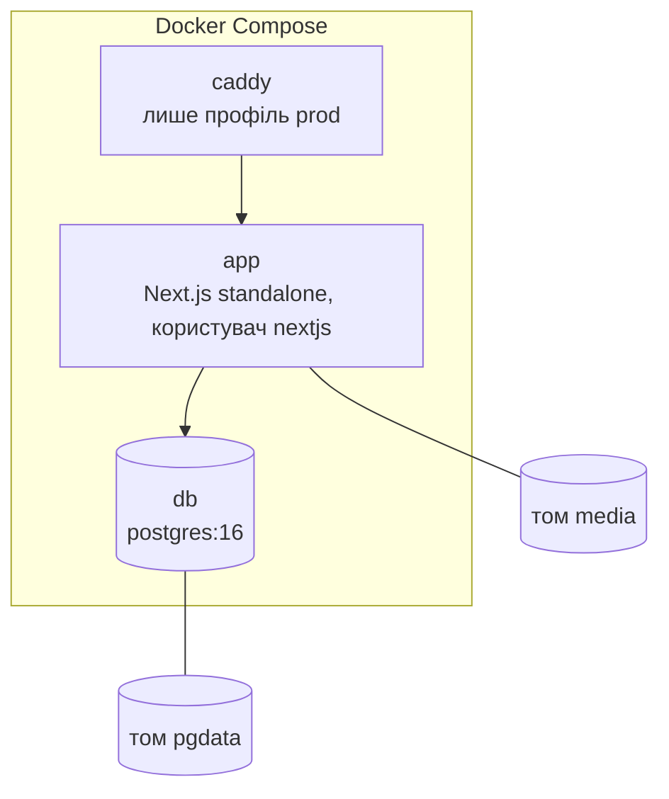
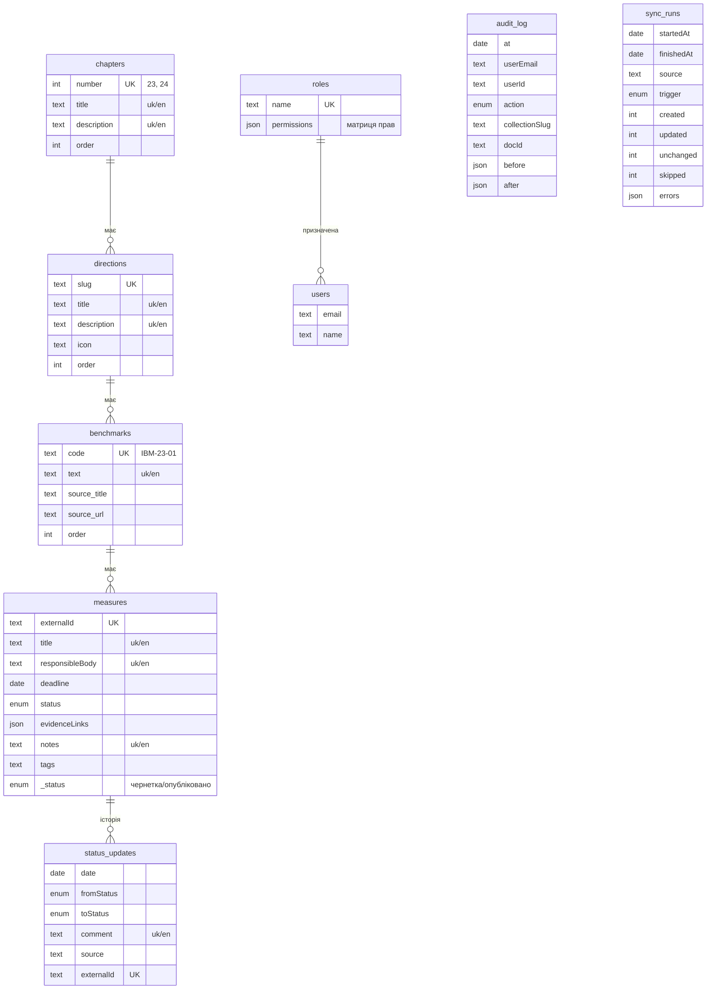

# Архітектура

## Огляд

Один застосунок Next.js 16 (App Router) з вбудованим Payload CMS 3. Один Docker-образ обслуговує:

| Шлях | Що |
|---|---|
| `/`, `/en/…` | публічний сайт (Server Components) |
| `/admin` | адміністративна панель Payload |
| `/api/<колекція>` | REST API Payload (з перевіркою прав) |
| `/api/v1/*` | відкритий API лише для читання |
| `/api/healthz` | перевірка стану (застосунок + база) |



Структура коду:

```
src/
  payload.config.ts      конфігурація Payload: колекції, локалі, завдання, міграції
  collections/           content.ts (моніторинг), site.ts (сайт), system.ts (ролі, аудит, імпорт)
  access/rbac.ts         єдина access-функція
  hooks/audit.ts         журнал аудиту (withAudit)
  hooks/revalidate.ts    скидання кешу публічних сторінок
  sync/                  імпорт із Google Sheets / CSV
  seed/                  ролі, перший адміністратор, демонстраційні дані
  migrations/            міграції БД (зокрема тригер журналу аудиту)
  lib/status.ts          статуси та розрахунок прогресу (чисті функції)
  lib/data.ts            читання даних для сторінок і API v1
  app/(frontend)/[locale]/   публічні сторінки
  app/(payload)/             адмінка і REST API Payload
  app/api/v1/                відкритий API
  components/                компоненти інтерфейсу; admin/ — компоненти адмінки
messages/uk.json, en.json    тексти інтерфейсу
data/sheets/*.csv            демонстраційні дані
```

## Модель даних



Колекції сайту: `pages` і `news` (заголовок, slug, блоки Text / Accordion / CTA / Embed, SEO), `media` (файл, обовʼязковий `alt`), `redirects` (звідки, куди, 301/302).

Версії та чернетки ввімкнено для `measures`, `pages`, `news`. Анонімні відвідувачі бачать лише опубліковані записи.

Відмінності від початкового ТЗ:

- у `audit_log` поле колекції називається `collectionSlug` (імʼя `collection` зарезервоване в Payload); користувач зберігається як `userId` + `userEmail` без зовнішнього ключа — інакше видалення користувача вимагало б `UPDATE` журналу, який заборонено;
- у `sync_runs` додано лічильник `unchanged` — він наочно показує ідемпотентність;
- `errors` — JSON-масив обʼєктів `{sheet, row, key, message}`.

## Статуси і прогрес

Статуси заходу, що зберігаються: `not_started`, `in_progress`, `done`, `partial`. Статус «прострочено» **не зберігається**: він обчислюється, якщо строк минув, а статус не `done` (у день строку захід ще не прострочений).

```
прогрес = (кількість done + 0,5 × кількість partial) / кількість заходів × 100, округлення до цілого
```

Розрахунок однаковий для орієнтира, напряму, глави і всіх заходів разом (`src/lib/status.ts`, покрито unit-тестами). Прострочений захід рахується за фактичним статусом.

Зміна статусу опублікованого заходу — в адмінці чи під час імпорту — автоматично створює запис у `status-updates` (хук `afterChange`).

## Ролі та права

Права зберігаються **в даних**, а не в коді. Колекція `roles` містить матрицю:

```json
{ "measures": { "read": true, "write": true, "delete": false }, "news": { "read": true } }
```

- `src/access/rbac.ts` — єдина функція `rbac(slug)`, підключена до всіх колекцій. Вона читає матрицю ролі поточного користувача і відповідає на `read / create / update / delete`.
- Редактор матриці (`components/admin/PermissionsMatrix.tsx`) — таблиця «колекція × дія». Список рядків будується з конфігурації автоматично.
- Вбудовані ролі створюються при першому старті: `admin` (повний доступ, системна), `editor` (контент + запуск імпорту), `analyst` (лише читання та експорт).
- Роль `admin` завжди має повний доступ, тож адміністратор не може випадково заблокувати себе.

**Додавання нової колекції:** створити конфігурацію, додати її до масиву `base` у `payload.config.ts` з `access: rbac('<slug>')`, згенерувати міграцію. Колекція зʼявляється в матриці, права призначаються в UI ролей. Файл `rbac.ts` не змінюється; аудит підключається сам.

Захист:

- останнього адміністратора не можна видалити чи позбавити ролі; роль `admin` не можна видалити чи перейменувати;
- поле `role` користувача може змінити лише той, хто має право запису на `users` (немає самопідвищення привілеїв);
- користувач без права читання `users` бачить лише власний запис;
- анонімний запис заборонений завжди.

## Журнал аудиту

`withAudit()` додає хуки `afterChange` і `afterDelete` до **кожної** колекції (у `payload.config.ts` — `.map(withAudit)`). Запис містить користувача, дію, колекцію, ID документа, стан «до» і «після», час. Паролі, хеші й сесії вилучаються.

Запис журналу створюється в тій самій транзакції, що й зміна: якщо записати в журнал не вдалося, зміна відкочується.

Незмінність — два рівні:

1. **Застосунок:** `create / update / delete` для колекції `audit-log` повертають `false` для всіх ролей, включно з `admin`; записи створює лише сервер.
2. **База даних:** тригери `audit_log_no_update_delete` і `audit_log_no_truncate` (міграція `20261122_000000_audit_log_immutable`) відхиляють `UPDATE`, `DELETE`, `TRUNCATE` з помилкою `audit_log is append-only`.

Експорт: `GET /api/audit-log/export` (CSV, потрібне право читання `audit-log`), посилання над списком в адмінці.

## Двомовність

- **Контент:** локалізація полів Payload (`uk` — за замовчуванням, `en`), з поверненням до `uk`, якщо перекладу немає.
- **Інтерфейс:** next-intl, `messages/uk.json` і `messages/en.json`; множина — через ICU (`one / few / many`).
- **Адреси:** `uk` без префікса, `en` з `/en/`. Маршрутизація — `src/proxy.ts`. Перемикач мови зберігає сторінку і параметри фільтрів.
- **SEO:** `canonical`, `hreflang` (`uk`, `en`, `x-default`), Open Graph, `sitemap.xml` з обома мовами.
- **Адмінка:** інтерфейс Payload українською та англійською.

## Публічні сторінки

| Адреса | Сторінка |
|---|---|
| `/` | загальний прогрес, глави, напрями, розподіл за статусами, останні оновлення, новини |
| `/glava-23` | глава: опис, прогрес, напрями |
| `/glava-23/sudova-reforma` | напрям: акордеон орієнтирів, заходи, фільтри `?status=&body=` |
| `/zakhid/<id>` | захід: поля, підтвердження, історія статусів |
| `/novyny`, `/novyny/<slug>` | новини з фільтром `?tag=` |
| `/metodolohiia` | формула, джерела, остання синхронізація |
| `/pro-proiekt` | про проєкт, дисклеймер |
| `/api-docs` | документація відкритого API |
| `/<slug>` | сторінки з колекції `pages` |

Невідома адреса спершу перевіряється в колекції `redirects` (301/302), потім — 404.

## Відкритий API

`GET /api/v1/progress`, `/chapters`, `/directions/{slug}`, `/measures?status=&direction=`, `/updates?since=`; усюди `?locale=uk|en`. Специфікація OpenAPI 3.1: `/api/v1/openapi.json`. Сторінка `/api-docs` будується з тієї ж специфікації на сервері, без сторонніх скриптів.

Обмеження: 60 запитів на хвилину з однієї адреси (in-memory, заголовки `X-RateLimit-*`, відповідь `429` з `Retry-After`). Лічильник живе в памʼяті одного процесу — для одного контейнера цього достатньо.

## Кешування і продуктивність

- Сторінки рендеряться на сервері під час запиту; збірка образу не потребує бази.
- Дані для сторінок кешуються (`unstable_cache`, тег `content`, 60 с). Будь-яка зміна в адмінці чи імпорт скидає кеш одразу (хук `revalidate`).
- Кільце й смуги прогресу — серверний SVG/HTML без JavaScript. Recharts (кільцева діаграма статусів) підвантажується окремим чанком після першого рендеру, місце під нього зарезервоване.

## Завдання за розкладом

Payload Jobs: завдання `syncSheets` ставиться в чергу `nightly` щодня о 03:00; черга обробляється вбудованим планувальником у процесі застосунку (`autoRun`). Вимикається змінною `ENABLE_JOBS=false`.

## Логи

Payload пише структуровані JSON-логи (pino) у stdout; `docker compose logs app`. Caddy — JSON-журнал доступу.
